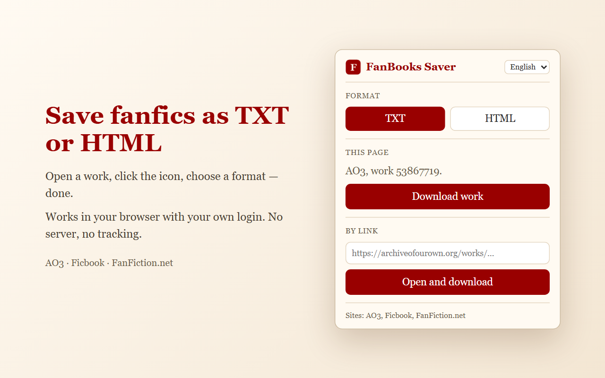

# FanBooks Saver

**English** · [Русский](README.ru.md)

A browser extension that saves a fanfic from the page you have open as a **TXT** or **HTML** file —
to read offline, on an e-reader, or just to keep.

## Supported sites

- [Archive of Our Own (AO3)](https://archiveofourown.org)
- [Ficbook](https://ficbook.net)
- [FanFiction.net](https://www.fanfiction.net)

Fanfics.me and Wattpad are coming later.

## Features

- **All chapters in one file** — with the work's header: title, author, tags, summary and notes.
- **The author's formatting is kept**: italics, bold, alignment, lists, images.
- **Three ways to download**: from the open page, by pasting a link, or from the right-click menu.
- **When AO3 is down**, the extension looks for a saved copy of the work on ao3saver and in the
  Internet Archive's Wayback Machine, and tells you where the copy came from and how old it is.
- **8 interface languages**: English, Русский, Українська, Қазақша, Español, Deutsch, Français, Italiano.

## Install

The Chrome Web Store page is coming soon. Until then, you can install it manually in Chrome,
Yandex Browser, Edge or any other Chromium-based browser:

1. [Download the project as a ZIP](../../archive/refs/heads/main.zip) and unpack it.
2. Open `chrome://extensions` (in Yandex Browser — `browser://extensions`).
3. Turn on **Developer mode** in the top right corner.
4. Click **Load unpacked** and choose the unpacked folder (the one with `manifest.json`).
5. Pin the extension: click the puzzle icon in the toolbar and pin FanBooks Saver.

Don't delete or move the folder afterwards — the browser loads the extension from it.

## How to use

1. Open any chapter of a work on a supported site.
2. Click the **F** icon in the toolbar.
3. Choose **TXT** or **HTML** and click **Download work**.

Progress is shown in the corner of the page; the file goes to your usual Downloads folder.
You can also paste a link to a work into the extension window, or right-click a link →
**Download work from link**.

## Privacy

Everything happens in your browser, with your own login on the site. The extension has no server,
no analytics and collects no data. See the [privacy policy](docs/privacy-policy.html).

It doesn't bypass site restrictions: if a work is visible only to logged-in users, you need to be
logged in. Comments, series and bookmarks are not downloaded — only the work itself.

## License

© 2026 Iuliia Kuzmina ([@vehgerli](https://github.com/vehgerli)).

[PolyForm Noncommercial 1.0.0](LICENSE.md): you may use, study and change the code for free for
any noncommercial purpose. Commercial use — selling, paid versions, ads — is not allowed.
