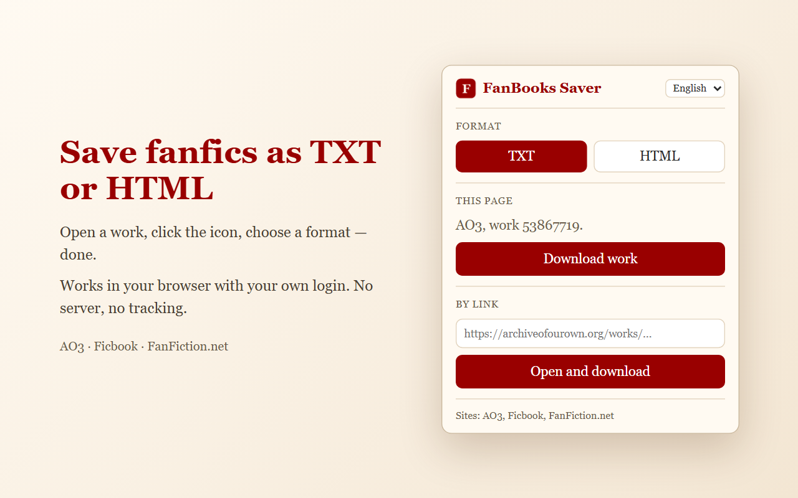

# FanBooks Saver

[English](README.md) · **Русский**

Расширение для браузера: сохраняет фанфик с открытой страницы в файл **TXT**, **HTML** или **EPUB** —
чтобы читать без интернета, на электронной книге или просто оставить себе.

## Сайты

- [Archive of Our Own (AO3)](https://archiveofourown.org)
- [Книга Фанфиков](https://ficbook.net)
- [FanFiction.net](https://www.fanfiction.net)
- [Fanfics.me](https://fanfics.me)
- [Wattpad](https://www.wattpad.com)

## Возможности

- **Все главы в одном файле** — вместе с шапкой работы: название, автор, метки, описание, примечания.
- **Оформление автора сохраняется**: курсив, жирный, выравнивание, списки, картинки.
- **Три способа скачать**: с открытой страницы, по вставленной ссылке или через меню правой кнопки.
- **Если AO3 недоступен**, расширение ищет сохранённую копию работы на ao3saver и в Wayback Machine
  (Internet Archive) и пишет, откуда копия и от какой она даты.
- **8 языков интерфейса**: English, Русский, Українська, Қазақша, Español, Deutsch, Français, Italiano.

## Установка

Страница в Chrome Web Store скоро появится. Пока расширение можно установить вручную в Chrome,
Яндекс Браузер, Edge или любой другой браузер на Chromium:

1. [Скачайте проект архивом ZIP](../../archive/refs/heads/main.zip) и распакуйте.
2. Откройте `chrome://extensions` (в Яндекс Браузере — `browser://extensions`).
3. Справа вверху включите **«Режим разработчика»**.
4. Нажмите **«Загрузить распакованное расширение»** и выберите распакованную папку (ту, где лежит `manifest.json`).
5. Закрепите расширение: значок пазла на панели → булавка у FanBooks Saver.

Папку потом не удаляйте и не перемещайте — браузер загружает расширение из неё.

## Как пользоваться

1. Откройте любую главу работы на одном из сайтов.
2. Нажмите значок **F** на панели браузера.
3. Выберите **TXT**, **HTML** или **EPUB** и нажмите **«Скачать работу»**.

Ход скачивания виден в углу страницы, файл попадёт в обычные «Загрузки». Ещё можно вставить ссылку
на работу в окошко расширения или нажать правой кнопкой по ссылке → **«Скачать работу по ссылке»**.

## Конфиденциальность

Всё происходит в вашем браузере, с вашим входом на сайт. У расширения нет сервера и аналитики,
оно не собирает никаких данных. Подробнее — в [политике конфиденциальности](https://vehgerli.github.io/fanbooks-saver/privacy-policy.html).

Расширение не обходит ограничения сайтов: если работа видна только после входа, нужно войти.
Комментарии, серии и закладки не скачиваются — только сама работа.

## Лицензия

© 2026 Iuliia Kuzmina ([@vehgerli](https://github.com/vehgerli)).

[PolyForm Noncommercial 1.0.0](LICENSE.md): бесплатно использовать, изучать и переделывать код
можно в любых некоммерческих целях. Коммерческое использование — продажа, платные версии,
реклама — запрещено.
